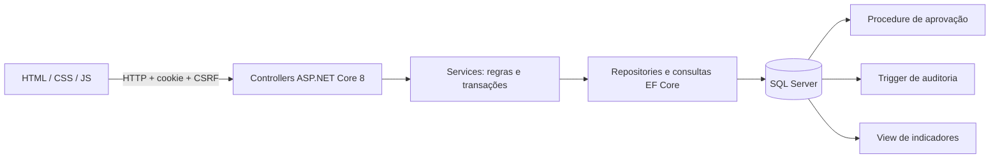

# Arquitetura

Preservados: projeto `PIM3SemBackend`, namespace `PIM_3sem_backend`, entidades de funcionário/usuário/departamento/perfil/salário/ponto e migrations do PIM III. A organização nova acrescenta o processo de gestão sem renomear o domínio.

`FuncionarioController` e `GestaoController` chamam `GestaoService`: valida escopo, salário, vínculos e estados. `GestaoRepository` centraliza a consulta com includes, filtro obrigatório de subordinados e a chamada parametrizada à procedure; oferece o DbContext como unidade de trabalho para consultas compostas e transações do serviço. Services/Repositories originais continuam disponíveis para os cadastros auxiliares e testes legados. Login e validação de sessão usam o DbContext diretamente para a consulta de autenticação.

O frontend é servido pela própria API (PhysicalFileProvider), preservando HTML/CSS/JS e marca. `js/config.js` centraliza `/api`, `api.js` trata HTTP, cookies e CSRF, `shared.js` cuida de navegação, feedback e paginação. Cada módulo tem seu JS. Dados de negócio são lidos do SQL, nunca de localStorage. A landing tem uma simulação explicitamente ilustrativa.

## Segurança e escopo

PasswordHasher do ASP.NET Core guarda hashes com salt; senhas antigas em texto puro não são aceitas, precisam de redefinição. Cookie HttpOnly, SameSite Strict, prazo de 4 horas e validação do usuário/perfil no banco a cada requisição. Cookie é Secure em HTTPS e aceita HTTP apenas para o fluxo local documentado. CSRF via antiforgery em toda mutação, incluindo login. Limite de 10 tentativas de login por minuto/IP. O frontend não decide permissões: todas as operações têm autorização no servidor.

Administrador e RH veem a organização; Gestor vê apenas subordinados diretos (inclusive indicadores, solicitações e auditoria). Gestor não cadastra, edita, inativa ou aprova. Colaborador mantém vínculo de acesso na modelagem original, mas não possui área autenticada nesta fase. Criar/administrar usuários diretamente é exclusivo de Administrador. Cookies revogados por inativação/perfil deixam de autorizar novas requisições.

`ContextoAuditoriaInterceptor` sobrescreve SESSION_CONTEXT UsuarioId em toda abertura lógica da conexão, inclusive do pool. O valor vem da identidade autenticada no servidor, nunca de um campo enviado pelo navegador. A trigger lê esse valor e resolve o e-mail no banco. Execuções sem usuário são Sistema. O seed autorizado define o contexto de RH apenas durante seu exemplo aprovado e o limpa em finally.

## Persistência e distribuição

Migrations possuem os scripts SQL como EmbeddedResource, então não dependem de um caminho de arquivo ao executar. Não use EnsureCreated, não reaplique scripts manualmente nem descarte o histórico de migrations. O frontend deve permanecer em `frontend/` relativo ao diretório da API; os scripts fornecidos executam a partir dessa estrutura. Um futuro pacote publish deve incluir essa pasta e configuração correspondente; não foi preparada distribuição pública nesta fase.

O SQL usa volume Docker independente do processo de API. `.local/` guarda somente configuração local, chaves de sessão, logs e resultados ignorados pelo Git; proteja o acesso ao diretório. O armazenamento local de chaves não usa um cofre de produção. As instruções de nuvem precisam reiniciar processos depois da restauração; processos não fazem parte de um snapshot.

## NexaCore AI — fase 2, não implementada

Fluxo previsto: pergunta autenticada → endpoint .NET → catálogo fechado de consultas autorizadas → services existentes → resposta agregada. Groq/Gemini só serão avaliados após política de dados, limites e credenciais pelo backend. Nenhuma chave no frontend. Não gerar SQL livre, não oferecer acesso direto ao banco e não alterar dados por comandos livres. Aplicar o mesmo escopo de subordinados e minimizar dados enviados externamente.
