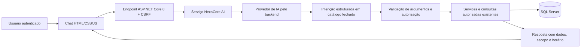

# NexaCore AI — próxima fase

**Estado atual: planejada, não implementada.** O MVP já possui autenticação, permissões, dados SQL, dashboard e solicitações; a próxima evolução pode reutilizar esses serviços. Este documento não instala SDK de provedor, não solicita chaves e não altera o funcionamento atual.

## Objetivo inicial

Um consultor de RH somente leitura para responder, em português, perguntas sobre dados que o usuário já pode consultar:

- Quantos colaboradores ativos temos?
- Como a equipe está distribuída por departamento?
- Quais solicitações estão pendentes?
- Quantos reajustes foram aprovados neste mês?
- Qual é o impacto dos reajustes na folha do meu escopo?

Gestor consulta apenas subordinados; RH/Admin consultam o escopo corporativo autorizado. Não incluir aprovação, rejeição, reajuste ou escrita por comando livre nesta primeira versão de IA.

## Fluxo proposto

O servidor mantém a identidade autenticada. O modelo não escolhe usuário, perfil ou escopo e não recebe credencial de banco. Mesmo que um prompt peça outro departamento ou papel, a execução aplica as permissões existentes.

## Implementação incremental proposta

| Etapa | Entrega | Dependência / validação |
|---|---|---|
| 1. Definir contrato | Catálogo de intenções: resumo, departamentos, pendências e reajustes por período; DTOs e limites | Definir quais informações podem sair do backend; minimizar dados individuais |
| 2. Escolher provedor | Avaliar Gemini/Groq e seus SDKs/endpoints .NET, custos, limites e tratamento de dados | Decisão do grupo e credencial configurada de forma privada |
| 3. Criar backend | Endpoint autenticado proposto `POST /api/ai/perguntas`, serviço e adaptador de provedor | Validação de intenção/argumentos, timeout, cancelamento e consultas existentes |
| 4. Integrar frontend | Painel de chat no visual NexaCore com carregamento, erros e acessibilidade | Respostas escapadas/renderizadas como texto, sem executar HTML do modelo |
| 5. Testar | Casos por perfil, consultas corretas, limites, indisponibilidade e tentativas de ampliar acesso | Fixtures de provedor e cenários SQL reais; teste externo separado e identificado |
| 6. Documentar | Variáveis, configuração segura, perguntas demonstrativas e limites reais | Registrar somente o que foi implementado e executado |

As etapas e nomes de arquivos/rotas são uma proposta; ainda não são contratos disponíveis no sistema.

## Controles a implementar

- Chave do provedor somente no backend, por configuração privada; nunca no JavaScript, Git, capturas ou logs. Não fornecer chaves pelo chat.
- Sem SQL gerado ou executado livremente pelo modelo. Intenções e parâmetros desconhecidos são rejeitados.
- Reutilizar filtros de escopo do usuário a cada consulta. O modelo não substitui a autorização do servidor.
- Preferir respostas agregadas. Enviar ao provedor apenas os dados fictícios e mínimos necessários para a função aprovada.
- Mostrar a base factual da resposta (período, escopo e valores consultados) e diferenciar ausência de dados de falha externa.
- Proteger o endpoint com sessão, CSRF, tamanho máximo de pergunta, limite de requisições e timeout/cancelamento.
- Não executar ações, seguir links ou instruções contidas em dados retornados pelo provedor.
- Não registrar texto integral com dados pessoais por padrão; definir retenção e histórico antes de persistir conversas.

## Critérios de aceite da fase

1. Perguntas do catálogo retornam dados iguais às consultas autorizadas do sistema.
2. Gestor não consegue obter dados de outro escopo, inclusive por manipulação do prompt.
3. Nenhuma pergunta altera o banco de negócio.
4. Falha, limite ou ausência de chave do provedor produz mensagem clara; não são exibidos números inventados.
5. A aplicação principal continua utilizável quando a IA está desativada ou indisponível.
6. Testes distinguem resultados simulados de chamadas reais ao provedor.

Próxima decisão necessária quando a implementação começar: provedor e política de envio de dados. A configuração local do MVP continua independente dessa escolha.
